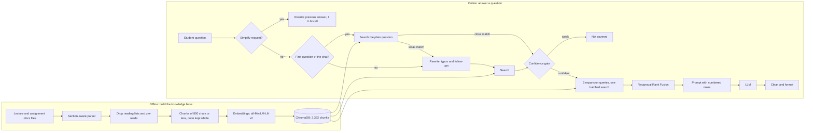

# StudyBuddy AI

**A study assistant that answers questions from my own lecture notes, code, tables and assignment guides, and says "not covered" when the notes don't contain the answer.**

Built as a RAG (Retrieval-Augmented Generation) pipeline over the lecture material of the IIT Kharagpur Gen AI and Agentic AI course. Free tools only. Pilot scale: it runs on my laptop for a small group of students.

> Planned work and decisions: [ROADMAP.md](ROADMAP.md). Measured results and findings: [evaluation_notes.md](evaluation_notes.md).

---

## Why this exists

Our cohort has long lectures, many notebooks and assignments, and not enough time. Some students watched the lecture and need a concept explained again in simpler words. Others missed it and need to catch up fast.

A normal chatbot doesn't know our lectures, so its answers use different terms and examples. Keyword search only finds pages with the exact words typed. StudyBuddy searches **by meaning** inside the course material, answers with the course's own terms and examples, and refuses when the notes don't cover the question.

## What it can do

| Capability | Status |
|---|---|
| Answer concept questions from the lecture notes in simple words | Working |
| Search code, tables and assignment guides along with the theory | Working |
| Handle typos ("what is atention") and follow-ups ("what about top-k?") | Working |
| "Explain more simply" / "give an analogy" in one fast LLM call | Working |
| "Explain the code line by line" using the previous answer | Working |
| Refuse off-topic questions instead of making up an answer | Working (20 of 20 in my test) |
| Chat page for a few students (Gradio, password, one at a time) | Next |
| Quiz mode, Telegram bot, larger pilot | Future work |

---

## Architecture

### The pipeline in plain words

1. **Index once.** Each lecture file is parsed into sections, split into chunks, converted to vectors and stored in ChromaDB.
2. **Route.** A short follow-up like "explain simpler" skips search and rewrites the previous answer. Other questions continue.
3. **Fast path.** For the first question of a chat, search the question as typed. If the best match is close (distance below 0.75), the rewrite call is skipped.
4. **Rewrite.** Otherwise a short LLM call (temperature 0) fixes typos and turns follow-ups into full questions using the chat history.
5. **Gate.** If the closest chunk is too far (distance 1.0 or more), the system says "not covered" without calling the LLM for an answer.
6. **Expand and merge.** The LLM writes 3 queries naming sub-concepts. One batched search runs all three, and results are merged by rank.
7. **Answer.** The top chunks go to the LLM, which writes one combined explanation in simple words. Code is cleaned and formatted for plain text.

---

## Engineering decisions and problems solved

Every item below started as a failure that I diagnosed with a small script before fixing.

### 1. Reading lists were outranking the real lessons
**Symptom:** answers only said where a topic was mentioned.
**Diagnosis:** a script printed the ranks for "attention". The chunks that taught it sat at ranks 71 to 96, below pre-reads full of topic words.
**Fix:** remove reading-list and pre-read sections at index time (41 chunks). A `PARSER_VERSION` stored with each lecture forces a clean re-index when the parser changes.

### 2. Short questions don't match explanations
A short question and a long explanation share few words. **Multi-query expansion** has an LLM write 3 queries naming sub-concepts, and each one searches separately. The prompt example uses a topic that is not in my test set, so the evaluation isn't leaked into the prompt.

### 3. Merging results from different queries
Distances from different queries can't be compared, so I merge by **rank** with Reciprocal Rank Fusion: `score = sum of 1 / (60 + rank)` over the queries.

### 4. A confidence gate that saves calls and avoids made-up answers
If the best chunk is too far, the system refuses before any answer call. Off-topic questions cost almost nothing.

### 5. The rewriter has safety nets
If the call fails, the original question is used. Only the first line is kept, and anything over 300 characters is discarded. Only confident turns are saved to history, so refused questions never pollute follow-ups.

### 6. Provider-agnostic LLM client
When Hugging Face returned `402 Payment Required`, I confirmed it was billing and not a bug, and moved to Groq's free tier. The OpenAI-compatible client made it a two-line change. The model is a reasoning model, so `max_tokens` needs headroom (1500 normally, 3000 for code and follow-ups). A cut-off answer is detected through `finish_reason` and flagged.

### 7. Clean, readable answers
Model output is cleaned in code: LaTeX fragments, Markdown italics, special hyphens, `*` bullets, and phrases like "from the notes" or "In the notes," that leak the source.

### 8. Conversation memory is small on purpose
The rewriter sees the last 2 turns. The full previous answer (capped) is added to the prompt only when the question refers to it ("the code", "this", "simpler"). This keeps tokens low on a free tier.

### 9. Examples and code come from the notes
My first evaluation showed the model inventing examples, and two had wrong numbers. The prompt now says to reuse the notes' own examples, calculations and code, and code questions also fetch chunks flagged `has_code`.

### 10. Speed: fewer calls, measured
After the first benchmark I found each question cost 3 LLM calls and search took longer than I guessed. I added the simplify route, the fast path and one batched search, and measured again on the same 20 questions (table below). Average time fell from 5.6 s to 3.2 s with the same quality screens.

---

## Evaluation

20 questions I wrote: 15 answerable and 5 off-topic. 5 are simplify turns and 5 are follow-ups. Same laptop, one run each. Full detail in [evaluation_notes.md](evaluation_notes.md).

| Check | Before (v3.1) | After (v4) |
|---|---|---|
| Average seconds per answered question | 5.6 | **3.2** |
| LLM calls per answered question | 3.0 | **2.0** |
| Search stage | 2.7 s (about 1.8 s typical) | 0.6 s |
| Rewrite call skipped | n/a | 10 of 15 answered |
| Refusal correct | 20/20 | 20/20 |
| Retrieval hit | 10/10 | 10/10 |
| Follow-up keeps its topic | 4/5 | 4/5 |
| Simplify answers at least 20% shorter | 3/5 | 4/5 |
| **Hand-scored answer correctness (my own review)** | - | **14 fully correct, 1 partly (invented example), of 15** |

**How I hand-scored:** I read each of the 15 answers and compared it with my course notes. I did not check every line or number against the source, so a small error can still be hiding. One answer (Q7) used an example that is not in the notes, so I count it as partly correct.

**Honest reading:** the automatic checks are easy to pass, so they show that nothing broke, not that every answer is right. The hand-scored line is the real accuracy number. The first question after startup takes about 8 s because the embedding model loads.

---

## Limitations

- **The model can invent an example** when the notes' own example is not among the 8 retrieved chunks (seen once in 15 answers). A re-ranker or relevance cutoff would help.
- **The notes can be wrong, and the assistant repeats them.** I found a model-size row in one lecture that disagrees with the paper.
- **Answers vary between runs.** The same question asked twice can give different examples.
- **Simplify answers are shorter but not always dramatically simpler.**
- **Small explanation errors remain,** for example describing a parameter's size slightly wrong. A reader should still check the notes for anything important.
- **Assignment files leak details** into general answers. Version for students: excluded with a search filter on the lecture name.
- **Fixed 8 chunks** add noise when only a few are relevant.
- **Small test:** 20 questions, one laptop, one run each. It is a pilot-scale result, not a production claim.
- **Free tier:** about 8,000 tokens per minute on this model, so a few students at a time, not a whole cohort.

## Design: the notes stay private

The repository holds only code. The lecture files and the vector database are excluded with `.gitignore`. The answer pipeline is one function (`answer_question`) separate from the chat loop, so a web page or bot can call it without changing the pipeline. Students see answers, not chunks. An answer is built from the notes, so some content always shows through; the limits on session length and queue slow down bulk copying but can't make the notes invisible.

## Future work

Quiz mode, Telegram bot, larger pilot, re-ranker or relevance cutoff, chunk overlap, hybrid search. See [ROADMAP.md](ROADMAP.md).

---

## Tech stack

Python, ChromaDB, sentence-transformers `all-MiniLM-L6-v2` (Chroma's default embedding), Groq (`openai/gpt-oss-20b`) through the `openai` client, python-docx, python-dotenv.

## Use it

**If you are in my cohort:** you don't install anything. All the cohort's lecture notes and assignment guides are already loaded on my side. I share a link to a chat page (coming next, see [ROADMAP.md](ROADMAP.md)), you open it, enter the password and ask. The notes stay with me and are not in this repo.

**If you are outside my cohort (or want to build on this code):** you can run your own copy over your own notes. The course notes and the built database are private and not in this repo, so you bring your own .docx notes.

1. Clone the repo and run `pip install -r requirements.txt`
2. Get a free key at [console.groq.com](https://console.groq.com). Copy `.env.example` to `.env` and paste the key after `GROQ_API_KEY=`.
3. Put your own lecture .docx files in the `lectures/` folder.
4. Build the knowledge base once: `python -m src.ingest.build_index`
5. Start the chat: `python rag_from_db.py`

Run the benchmark with `python eval_twenty.py baseline`, or compare two runs with `python eval_twenty.py compare baseline fastpath`. The question list inside the script uses my course's topics; replace it with questions about your own notes.